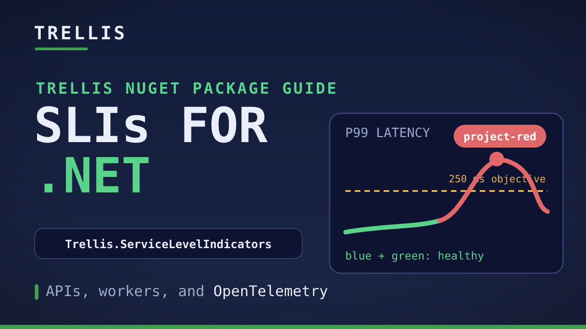

# Trellis.ServiceLevelIndicators

> **Your service can look healthy while one customer's operations are failing.**

**Measure customer impact, not just HTTP response times.** Trellis SLI emits business-operation latency metrics in milliseconds, with the customer resource, location, operation, and outcome attached. Build availability and latency objectives that reveal problems aggregate request metrics can hide.

[](https://github.com/xavierjohn/Trellis.ServiceLevelIndicators/actions/workflows/build.yml)
[](https://www.nuget.org/packages/Trellis.ServiceLevelIndicators)
[](https://www.nuget.org/packages/Trellis.ServiceLevelIndicators.Asp)
[](https://www.nuget.org/packages/Trellis.ServiceLevelIndicators.Asp.ApiVersioning)
[](https://dotnet.microsoft.com/download)
[](LICENSE)

**[Try the live demo](#try-the-live-demo)** | [Get started](#installation) | [Focused examples](#focused-examples) | [Integration guide](docs/usage-reference.md) | [Watch the video](https://youtu.be/jpReYDjaEH0)


*Real metrics from the included demo, with simulated incidents. Compare the service-wide cards with the per-project charts: one struggling project tells a different story.*

## Why Trellis SLI?

| The problem | What becomes visible |
|---|---|
| **Averages hide customer-specific incidents.** | Break down operations by `CustomerResourceId`, `LocationId`, and `Operation` instead of treating every request as the same experience. |
| **200 OK does not mean fast enough.** | Opt into exact within/exceeded latency-threshold counts. Measure compliance directly rather than estimating it from p95. |
| **A fast failure is still a failure.** | Track availability separately from latency. A fast 429 can meet the latency objective while failing availability. |
| **Caller mistakes look like service outages.** | Distinguish `ClientError` from `Failure`, keeping caller errors visible without including them in the default SLO population. |

Use the same SLI model in **ASP.NET Core MVC, Minimal APIs, versioned APIs, workers, and console apps**. Built on [`System.Diagnostics.Metrics`](https://learn.microsoft.com/dotnet/api/system.diagnostics.metrics) and **OpenTelemetry**; use your existing metrics backend.

## Try the live demo

**One command. Docker only. No local .NET SDK required.** With Docker running Linux containers, start the complete demo from the repository root:

```powershell
docker compose -f .\sample\Observability\Grafana\docker-compose.yml --profile demo up --build -d
```

Open the [live SLI dashboard](http://localhost:3000/d/trellis-sli?var-operation=SyncProject). The Project Tracker API, continuous traffic generator, Collector, Prometheus, and Grafana all run locally.

Healthy background traffic continues while slowdowns, failures, caller errors, throttling, and recovery repeat automatically. Start with **SyncProject / All projects**, then isolate **project-red** and compare it with the healthy projects.

**[Follow the guided walkthrough](sample/Observability/Grafana/README.md)** for what to investigate, how the SLIs are calculated, source-code pointers, and shutdown instructions. This is a local learning environment, not a production deployment.

### Video guide

<details>
<summary>Watch the complete NuGet guide</summary>

[](https://youtu.be/jpReYDjaEH0)

</details>

## What gets measured

The default meter is `Trellis.SLI`. Its `operation.duration` histogram records elapsed time in **milliseconds**, with these stable dimensions:

| Dimension | Meaning |
|---|---|
| `CustomerResourceId` | The **target resource**, such as the project, tenant, or subscription being operated on. Not the caller's identity or a request ID. |
| `LocationId` | Where the service runs, set once from deployment configuration. |
| `Operation` | A named business operation or HTTP method plus route template. Route values are never substituted into the default operation name. |
| `Outcome` | `Success`, `Failure`, `ClientError`, or `Ignored`. |

ASP.NET Core adds HTTP method/status and request-abort diagnostics. The API-versioning package adds `http.api.version`.

Built-in `http.server.request.duration` metrics remain useful: their unit is seconds, not a limit on timing precision, and they include status/error diagnostics. Trellis adds an explicit SLI outcome policy and service-specific dimensions, with the same model available outside HTTP.

For default availability, use **`Success / (Success + Failure)`**. Common caller errors are `ClientError`; 429 and 5xx are `Failure`. Observed request aborts are `Ignored`. For latency, opt into `operation.duration.threshold.count` to count operations within/exceeding configured millisecond boundaries; the duration histogram remains unchanged.

Latency thresholds classify elapsed time; they do not enforce timeouts or determine success/failure.

Choose the eligible population deliberately. The demo treats availability and latency as separate objectives; a successful-and-fast objective can instead require both. See [status semantics](docs/usage-reference.md#status-semantics) and [latency SLO recipes](docs/usage-reference.md#threshold-latency-objectives), including slow-abort and no-data handling.

## Installation

Requires **.NET 10**. Choose the package for your application:

| Application | Package |
|---|---|
| Console, worker, or shared library | [`Trellis.ServiceLevelIndicators`](https://www.nuget.org/packages/Trellis.ServiceLevelIndicators) |
| ASP.NET Core MVC or Minimal APIs | [`Trellis.ServiceLevelIndicators.Asp`](https://www.nuget.org/packages/Trellis.ServiceLevelIndicators.Asp) |
| ASP.NET Core with Asp.Versioning | [`Trellis.ServiceLevelIndicators.Asp.ApiVersioning`](https://www.nuget.org/packages/Trellis.ServiceLevelIndicators.Asp.ApiVersioning) |

The ASP.NET Core package includes core; the API-versioning package includes ASP.NET Core integration.

**Source-tree availability:** result selectors, endpoint exclusions, and the instrumentation failure policy were added after `10.0.0-preview.37`. Use a package containing those changes for those APIs. The Docker demo builds the current source directly.

### A complete Minimal API setup

From an ASP.NET Core project, install SLI and the OpenTelemetry hosting/exporter packages:

```shell
dotnet add package Trellis.ServiceLevelIndicators.Asp --prerelease
dotnet add package OpenTelemetry.Extensions.Hosting
dotnet add package OpenTelemetry.Exporter.OpenTelemetryProtocol
```

Replace `Program.cs` with:

```csharp
using OpenTelemetry.Metrics;
using OpenTelemetry.Resources;
using Trellis.ServiceLevelIndicators;

var builder = WebApplication.CreateBuilder(args);

builder.Services.AddOpenTelemetry()
    .ConfigureResource(resource => resource.AddService(builder.Environment.ApplicationName))
    .WithMetrics(metrics =>
    {
        metrics.AddServiceLevelIndicatorInstrumentation();
        metrics.AddOtlpExporter();
    });

builder.Services.AddServiceLevelIndicator(options =>
{
    options.LocationId = ServiceLevelIndicator.CreateLocationId("public", "westus3");
    options.AutomaticallyEmitted = false;
    options.LatencyThresholds.Add(TimeSpan.FromMilliseconds(250));
});

var app = builder.Build();
app.UseServiceLevelIndicator();

app.MapGet("/projects/{projectId:regex(^project-(blue|green|red)$)}",
    ([CustomerResourceId] string projectId) => Results.Ok(new { projectId }))
    .AddServiceLevelIndicator("GetProject");

app.Run();
```

Run with `dotnet run --urls http://localhost:5200` and request `http://localhost:5200/projects/project-blue`. The sample bounds project IDs deliberately; adapt these to your application's stable resource identifiers and cardinality budget.

The OTLP exporter defaults to `http://localhost:4317`. Set `OTEL_EXPORTER_OTLP_ENDPOINT` for your collector. The [included observability stack](sample/Observability/Grafana/README.md) can receive these metrics. Use your actual deployment location instead of the example region; no Azure SDK dependency is needed.

For MVC, register controllers and chain `.AddMvc()` after `AddServiceLevelIndicator(...)` so SLI attributes are applied. See the [MVC integration guide](docs/usage-reference.md#aspnet-core-mvc) or [versioned MVC example](sample/WebApiVersioned/Program.cs).

## Background jobs and workers

Use the core package without any ASP.NET Core dependency. Prefer `Measure` / `MeasureAsync` for automatic outcome handling:

```csharp
async Task SyncProjectAsync(ServiceLevelIndicator sli, CancellationToken cancellationToken)
{
    await sli.MeasureAsync("SyncProject", () => Task.Delay(75, cancellationToken));
}
```

Configure a stable `CustomerResourceId` for the workload. Successful completion records `Success`; exceptions record `Failure`; `OperationCanceledException` records `Ignored`. Exceptions still propagate to the application. Result selectors can classify failures returned as values.

Raw `StartMeasuring(...)` scopes default to **`Ignored`**, not success or failure. If you use one, explicitly classify every completion, exception, and cancellation path. See the [core guide](docs/usage-reference.md#core-package) and [runnable console example](sample/ConsoleApp/Program.cs).

## Focused examples

Start with the always-on demo for the full experience. These smaller examples isolate individual integration APIs without maintaining competing demo stacks:

| Example | What it teaches |
|---|---|
| [Always-on Project Tracker](sample/Observability/Grafana/README.md) | MVC instrumentation, continuous incidents, exact latency counts, and customer-specific Grafana SLIs |
| [Console](sample/ConsoleApp/Program.cs) | Core-only measurement, custom meter ownership/registration, and console export |
| [Minimal API](sample/MinApi/Program.cs) | Endpoint opt-in, named operations, target-resource metadata, and bounded dimensions; health and docs remain unmeasured |
| [API-versioned MVC](sample/WebApiVersioned/Program.cs) | The same project operation separated by `http.api.version` |

**[Run the focused examples](docs/usage-reference.md#running-the-focused-examples)** for commands, URLs, and expected metrics. The web examples share the demo's Collector/Prometheus/Grafana stack; their `Api.http` files contain ready-to-send requests.

## Integration and operational reference

Keep metric dimensions stable: no personal names, emails, request IDs, timestamps, or arbitrary free text. `CustomerResourceId` identifies the target, even when a caller acts across tenants; enrichment must not silently replace it with the caller's tenant.

| Topic | Guide |
|---|---|
| Integration and configuration | [Usage reference](docs/usage-reference.md) |
| Outcome policies and aborts | [Status semantics](docs/usage-reference.md#status-semantics) |
| Exact latency objectives and queries | [Threshold latency objectives](docs/usage-reference.md#threshold-latency-objectives) |
| Custom meters and disposal | [Custom meter registration](docs/usage-reference.md#custom-meter-registration) |
| Endpoint exclusions | [Exclude endpoints](docs/usage-reference.md#exclude-endpoints-from-automatic-sli-measurement) |
| Additional dimensions | [Enrichment and bounded attributes](docs/usage-reference.md#enrichment-and-bounded-attributes) |
| Recording/classifier/enrichment failures | [Instrumentation failure policy](docs/usage-reference.md#instrumentation-failure-policy) |
| Coding-assistant package guides | [Optional API guidance](docs/usage-reference.md#optional-api-guidance-for-coding-assistants) |
| SQL cancellation fixture | [Provider cancellation integration](docs/usage-reference.md#provider-cancellation-integration) |

API references: [Core](docs/api_reference/trellis-api-sli.md) | [ASP.NET Core](docs/api_reference/trellis-api-sli-asp.md) | [API Versioning](docs/api_reference/trellis-api-sli-apiversioning.md).

## Related repositories

- [`xavierjohn/Trellis`](https://github.com/xavierjohn/Trellis) — the framework: `Result<T>`, `Maybe<T>`, value objects, DDD primitives, ASP.NET / EF Core / Mediator integration. SLI metrics integrate naturally with Trellis pipeline behaviors.
- [`xavierjohn/Trellis.Microservices`](https://github.com/xavierjohn/Trellis.Microservices) — microservice trust-boundary packages: YARP gateway minting internal JWTs + consumer-side actor provider.
- [`xavierjohn/Trellis.Templates`](https://github.com/xavierjohn/Trellis.Templates) — `dotnet new trellis-asp` single-service Clean Architecture and `dotnet new trellis-microservices` Aspire-based microservices templates.

## License

[MIT](LICENSE).