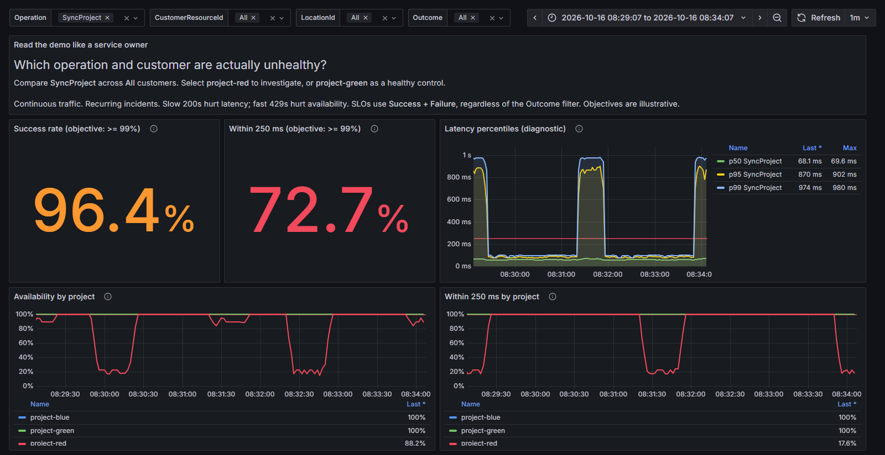

# Always-on SLI demo

See what Trellis SLI adds beyond generic HTTP request metrics: identify an unhealthy business operation, isolate the affected customer resource, and distinguish availability failures from slow successful operations.

The demo behaves like a small running service. It sends real HTTP traffic to a Project Tracker API continuously, keeps healthy background traffic flowing for every project, and automatically repeats localized incidents and recovery. Measurements pass through the real pipeline:

```text
HTTP traffic -> Project Tracker API + Trellis SLI -> OTLP Collector -> Prometheus -> Grafana
```

There is no external application or downstream service to configure. The operating conditions are simulated; the emitted SLI measurements are real.

## Start everything with one command

You need Docker Engine 25 or newer with Linux containers and Docker Compose v2.20.2 or newer. No local .NET SDK is required. The first build downloads the .NET images and restores the sample's NuGet dependencies; subsequent starts use cached images. Restores are cached separately, and each image copies only its own project graph so unrelated source edits do not rebuild both images.

From `sample\Observability\Grafana`:

```powershell
docker compose --profile demo up --build -d
```

Open the [live SLI dashboard](http://localhost:3000/d/trellis-sli?var-operation=SyncProject). Allow a few seconds after startup for the first metric exports and scrapes.



*Actual emitted metrics from simulated incidents: red degrades while blue and green remain healthy.*

The command starts five services:

| Service | Purpose |
|---|---|
| `demo-api` | Project Tracker API at http://localhost:5199, instrumented with Trellis SLI |
| `demo-traffic` | Continuous HTTP traffic and recurring incidents |
| `otel-collector` | Receives the API's OTLP metrics |
| `prometheus` | Scrapes and stores the exported metrics |
| `grafana` | Provisioned dashboard at http://localhost:3000 |

Compose starts `demo-traffic` only after the API's HTTP `/health` probe succeeds. The probe receives an explicit URL; it never starts a host or tries to interpret Kestrel configuration. The `SLI_DEMO_PORT` environment variable defaults to `8080` and supplies the API binding, probe URL, published-port target, and generator URL together. Set it before running Compose to change the internal port; the public API address remains http://localhost:5199. Probes use the existing .NET runtime, not an extra curl dependency, and run every five seconds during startup and every 30 seconds afterward.

The Docker `demo` profile is optional: plain `docker compose up -d` still starts only the observability stack for use with other samples. All published ports are bound to loopback. Grafana permits anonymous admin access for this local demo; do not expose this configuration as a production deployment.

All five services rotate their JSON logs at 10 MB and retain at most three files per service. This bounds container log storage during a prolonged incident.

Prometheus retention is configured for 24 hours or 256 MB, whichever triggers first, rather than its default 15 days. Retention deletes persisted blocks in the background; the active head, write-ahead log, and compaction can require additional space, so this is not a hard disk quota.

## Explore it like a service owner

Start with **Operation = SyncProject**, **CustomerResourceId = All**, and a recent five-minute time range.

| Question | What to inspect | What the library makes visible |
|---|---|---|
| Is every customer affected? | **Availability by project** and **Within 250 ms by project** | `project-red` degrades while the other projects remain healthy. Aggregate service metrics can dilute this difference. |
| Are successful requests still too slow? | **Within 250 ms** versus **Success rate** | Slow 200 responses hurt latency compliance without being availability failures. Histogram percentiles are useful diagnostics, not the exact threshold SLI. |
| Are caller mistakes being counted as outages? | Blue project's 400/`ClientError` volume alongside its SLIs | Caller errors are visible but excluded from both SLO populations; healthy blue requests continue. |
| Is a fast response necessarily good service? | Red project's capacity-pressure phase | Fast 429 responses hurt availability even when they meet the latency threshold. |
| Is the problem specific to one operation? | Compare **SyncProject** with **GetProject** | Named operations expose the slow sync path while project reads remain healthy. |

Then select **CustomerResourceId = project-red** to inspect its current availability and latency cards. Switch to `project-green` for a healthy control, or `project-blue` to investigate caller errors. Returning the customer filter to **All** restores the side-by-side comparison.

### The recurring workload

Each phase lasts approximately 30 seconds. The five-phase cycle takes roughly two and a half minutes, plus time to drain in-flight requests, and repeats until you stop it. It does not leave the dashboard idle after recovery.

| Phase | Traffic | Expected SLI effect |
|---|---|---|
| Healthy baseline | Fast 200 responses across all three projects | Availability and latency compliance settle near 100%. |
| Targeted project-red incident | Slow 200s and delayed 503s mixed with healthy red traffic | Red's latency compliance and availability fall; other projects stay healthy. |
| Client-error burst | Some blue sync requests return 400; healthy blue traffic continues | Blue's `ClientError` volume rises, but its SLOs remain healthy. |
| Capacity pressure | Some red sync requests return fast 429s; healthy red traffic continues | Red's availability falls while latency can remain within 250 ms. |
| Recovery | Fast 200 responses across all three projects | Both SLIs recover before the next cycle. |

Reads continue throughout. Every phase also retains healthy sync requests for every project. Operating modes and affected projects are repeatable; the API independently selects each request's delay from that mode's fixed palette. The generator schedules against elapsed time for a target rate of 12 requests/second, not an exact throughput guarantee or a load benchmark.

At most 32 requests can be in flight. If the API hangs or a higher configured rate reaches that limit, the generator logs backpressure and slows down until requests complete. Completed tasks are retired, and missed send slots are skipped rather than queued for a catch-up burst.

To see the current phase and HTTP response counts:

```powershell
docker compose --profile demo logs -f demo-traffic
```

Ctrl+C exits the log viewer; it does not stop the running demo.

In continuous mode, the first transport failure and first timeout in each phase are logged immediately. Further failures are counted without repeating individual diagnostics; phase summaries retain every `transport-failures` and `timeouts` count. The generator keeps running and resumes successful traffic when the API recovers. It adds no application-level retries or circuit breakers and leaves the intentional 429/503 responses unchanged. These client-side counts do not fabricate server SLI observations; use outside-in checks to detect an unreachable service.

### What the two SLIs mean

All availability and latency-compliance panels use **only `Success` and `Failure`** operations. `ClientError` and `Ignored` do not enter either denominator, regardless of the **Outcome** dropdown:

- **Availability:** `Success / (Success + Failure)`, with an illustrative objective of at least 99%.
- **Latency:** operations completed in **250 ms or less** divided by all eligible operations, also with an illustrative 99% objective. A fast failure can meet the latency objective while still hurting availability.

The latency panels use the opt-in threshold counter's `within` and `exceeded` counts, not estimated histogram quantiles. The comparison to 250 ms is inclusive. The displayed recent percentages use Prometheus `rate`; p50/p95/p99 remain diagnostic estimates across all outcomes.

The **Outcome** dropdown filters request volume, not the SLO population. Percentage cards use the current rate window, not an older healthy value. If traffic stops or a selection has only excluded outcomes, they show **No data**, not 100% compliance.

The API exports every second, the Collector batches for up to one second, and Prometheus scrapes and Grafana refreshes every two seconds. Percentages also use a rolling rate window, so previous-phase traffic must age out before a phase settles. Keep the five-minute dashboard range while learning the demo; longer ranges can blend phases.

Timing includes real processing and scheduling, so startup warm-up and local machine load can affect the readings. These objectives are illustrative, not guarantees from the library.

## Connect the dashboard to the code

The demo uses three stable project IDs: `project-blue`, `project-green`, and `project-red`. Unknown IDs return 404 under the library's fixed `Unknown` dimension, never the arbitrary rejected ID. These requests also increment the unknown-customer diagnostic counter. `/health` is explicitly excluded from SLI measurement.

The default workload uses only known projects, so the **Unknown customer diagnostics** panel normally has no activity. To exercise it, send `GET http://localhost:5199/api/projects/missing-project` twice, at least five seconds apart so Prometheus can observe a counter increase. The requests remain `ClientError` operations and are excluded from both SLO populations.

| Source | What to look for |
|---|---|
| [`Program.cs`](../../SliProductionDemo/Program.cs) | `AddServiceLevelIndicator`, OpenTelemetry registration, a 250 ms threshold, location, and health exclusion |
| [`ProjectsController.cs`](../../SliProductionDemo/Controllers/ProjectsController.cs) | Named `GetProject`/`SyncProject` operations and `[CustomerResourceId]` on the target project |
| [`GenerateSli/Program.cs`](../../GenerateSli/Program.cs) | Deterministic traffic, recurring incidents, readiness, and graceful cancellation |

The API opts into exact threshold counting with:

```csharp
options.LatencyThresholds.Add(TimeSpan.FromMilliseconds(250));
```

Grafana queries the library's existing metric contract:

- `operation.duration`, exported as `operation_duration_milliseconds_*`
- `operation.duration.threshold.count`, exported as `operation_duration_threshold_count_total`
- dimensions `CustomerResourceId`, `LocationId`, `Operation`, and `Outcome`
- threshold labels `sli_latency_threshold_ms` and `sli_latency_result`
- histogram-only HTTP method and response-status dimensions

No request IDs, timestamps, raw error messages, or other unbounded values are used as SLI dimensions.

## Stop or reset the demo

```powershell
docker compose --profile demo down
```

This stops the API, generator, and observability services. Prometheus and Grafana data volumes are retained. For a clean start that **deletes this Compose project's saved metrics and Grafana state**, use:

```powershell
docker compose --profile demo down --volumes
```

All services, including the standalone observability stack, restart after an unexpected exit or Docker/host restart. Stopping them with Compose prevents automatic restart until you start them again.

## Troubleshooting

- **A port is already in use:** stop an earlier copy of the stack or a locally running sample API. The demo uses localhost ports 3000, 4317, 4318, 5199, 9090, and 9464.
- **No metrics after startup:** check `docker compose --profile demo ps` and `docker compose --profile demo logs demo-api demo-traffic otel-collector`. Compose waits for `demo-api` to become healthy before starting traffic. The generator also keeps a bounded 30-second readiness check for local runs and startup races after an API restart.
- **The API stays unhealthy:** inspect `docker compose --profile demo logs demo-api` and its healthcheck output with `docker inspect`. Compose starts `demo-traffic` only after `demo-api` is healthy. If the API stays unhealthy after its 30-second start period and three 30-second retries, `docker compose --profile demo up` stops with `dependency failed to start`, and `demo-traffic` is not started. Fix the API, then run the command again.
- **The API restarts during a run:** continuous traffic logs and counts transport failures and timeouts without exiting. Successful requests resume when the API is reachable again; no generator restart is needed.
- **No data after changing filters:** select `SyncProject` and one of the three known projects, or reset customer/location/outcome filters to **All**. Check that `demo-traffic` is running and keep a recent time range.
- **The first build fails to download dependencies:** confirm Docker can reach Microsoft's container registry and NuGet.org.

## Optional: run the API and generator locally

For debugging, install the .NET 10 SDK, start only the observability stack with `docker compose up -d`, and use two additional terminals in this directory. Do not also start the Docker `demo` profile.

API:

```powershell
$env:OTEL_EXPORTER_OTLP_ENDPOINT = "http://localhost:4317"
$env:OTEL_METRIC_EXPORT_INTERVAL = "1000"
$env:ASPNETCORE_URLS = "http://localhost:5199"
dotnet run --no-launch-profile --project ..\..\SliProductionDemo\SliProductionDemo.csproj
```

To check the same API, pass its reachable health URL explicitly:

```powershell
dotnet run --no-launch-profile --project ..\..\SliProductionDemo\SliProductionDemo.csproj -- `
  --health-check http://localhost:5199/health
```

Probe mode accepts only `--health-check <URL>` and never loads host configuration. If you customize Kestrel, point the probe at a reachable HTTP or HTTPS listener instead of passing host arguments. HTTPS uses normal certificate validation. A successful response exits 0; HTTP failures, connection errors, and timeouts exit 1; invalid probe arguments exit 2.

Traffic:

```powershell
dotnet run --project ..\..\GenerateSli\GenerateSli.csproj -- `
  --base-url http://localhost:5199 `
  --phase-seconds 30 `
  --requests-per-second 12 `
  --continuous `
  --wait-for-ready
```

Omit `--continuous` for a single five-phase run. Its first request transport failure or timeout stops further sends, cancels/drains outstanding requests, and exits with code 1. Requested shutdown takes precedence over request errors while draining. Secondary cleanup failures are reported without replacing the initiating failure; unexpected request errors also produce a concise diagnostic and exit code 1. Invalid options print a concise error and usage with exit code 2.

Numeric arguments accept digits only: `--requests-per-second` is 1-1000 and `--phase-seconds` is 1-3600. Their defaults remain 12 and 30; continuous mode can repeat indefinitely.

Ctrl+C stops either local process gracefully. A second Ctrl+C forces the generator to exit if graceful request draining is stuck; a second SIGTERM also permits termination on Linux and macOS. Windows SIGTERM cannot be canceled by .NET; use Ctrl+C for graceful native Windows shutdown. Stop both processes before running `docker compose down`.

The [focused Minimal API and API-versioned examples](../../../docs/usage-reference.md#running-the-focused-examples) can reuse this stack and already configure the 250 ms threshold. Their `Api.http` files contain example requests; this traffic generator targets only the continuous demo's Project Tracker API. The dashboard aggregates matching SLI dimensions across services, so stop the focused examples when exploring the continuous demo in isolation.
